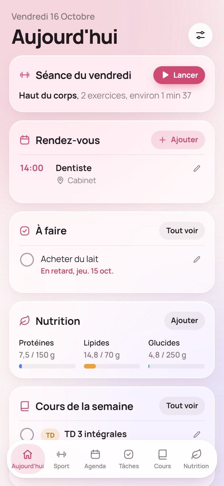
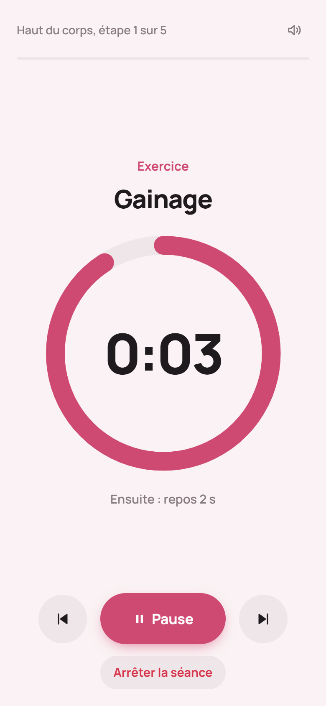
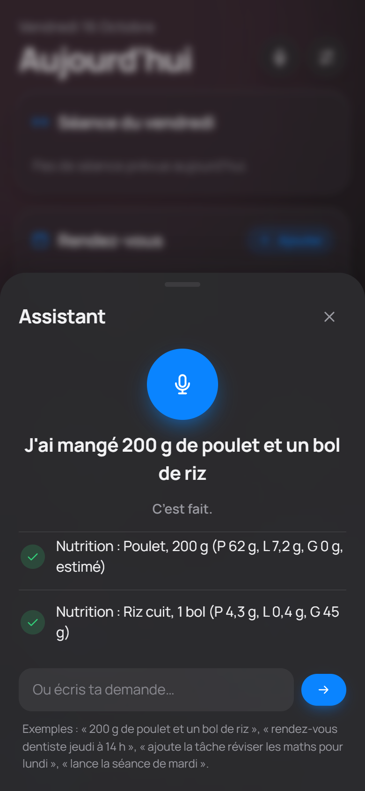
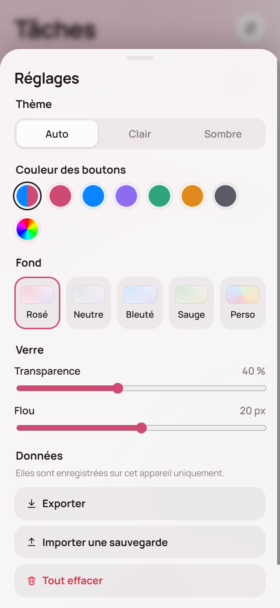
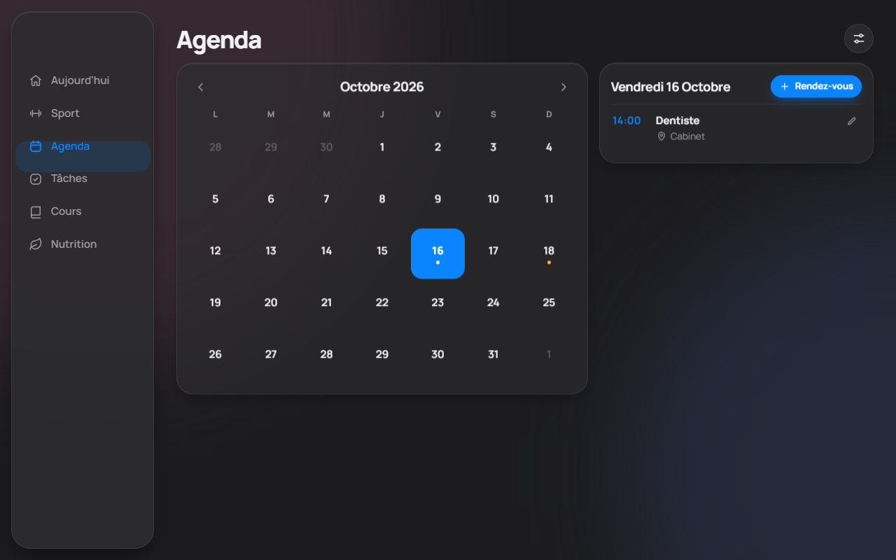

# Life : ton tableau de bord de vie quotidienne

Une web app personnelle, installable sur téléphone et ordinateur, pour regrouper au même endroit :

- **Sport** : ton programme jour par jour (séries, répétitions, durées, repos, vidéo YouTube de chaque exercice) et un **minuteur** qui enchaîne toute la séance, avec bips, vibrations et annonce vocale.
- **Agenda** : tes rendez-vous, synchronisés avec **Google Agenda**.
- **Tâches** : ta to-do list, synchronisée avec **Google Tasks**.
- **Cours** : rangés automatiquement depuis un dossier **Google Drive**, avec aperçu des PDF dans l'app.
- **Nutrition** : protéines, lipides, glucides et calories, comparés à tes objectifs, avec un bilan sur 7 jours.
- **Assistant vocal** (Gemini) : « 200 g de poulet et un bol de riz », « rendez-vous dentiste jeudi à 14 h », « lance la séance de mardi »…
- **À la montre ou au téléphone**, avec Gemini : « ajoute la tâche repas 30 g de protéines de cacahuètes » arrive tout seul dans Nutrition.

| Mobile | Minuteur | Assistant | Réglages |
|---|---|---|---|
|  |  |  |  |



Style « verre », thème clair et sombre, couleurs et transparence réglables, en français.

> **Projet personnel, non officiel.** Life n'est ni affilié à Google, Cloudflare ou Samsung, ni approuvé par eux. Les noms et marques cités appartiennent à leurs propriétaires. Les estimations nutritionnelles ne remplacent pas l'avis d'un professionnel de santé.

---

## Comment ça marche

**Chacun héberge sa propre copie.** Il n'y a pas de site commun : tu installes Life sur **ton** compte Cloudflare (gratuit) et tu le relies à **ton** compte Google. Personne d'autre que toi ne voit tes données, et tu n'as rien à payer pour un usage personnel.

```
Téléphone / PC / Mac ──► ton site Life (Cloudflare Workers) ──► Google Agenda, Tasks, Drive (ton compte)
                                     │                      └─► API Gemini (ta clé)
                                     └─ tes données synchronisées (Durable Object)
```

**Deux façons de l'utiliser :**

| | Sans serveur | Complet |
|---|---|---|
| Hébergement | n'importe quel hébergeur de fichiers statiques, ou en local | Cloudflare Workers (gratuit) |
| Données | dans le navigateur de chaque appareil | synchronisées entre tes appareils |
| Agenda, tâches, cours Google | ❌ | ✅ |
| Assistant vocal Gemini | ❌ | ✅ |
| Installation | 2 minutes | environ 45 minutes, une seule fois |

Pour la version sans serveur, il suffit de servir le dossier (par exemple `python -m http.server 8080`), puis d'ouvrir `http://localhost:8080`.

---

## Installation complète

Il te faut :
- un compte **GitHub** ;
- un compte **Cloudflare** (gratuit) ;
- un compte **Google** (Gmail) ;
- pour l'assistant vocal, une clé **Gemini** gratuite.

### 1. Copier le projet
Clique sur **Fork** en haut de cette page. Tu as maintenant ta propre copie du dépôt.

### 2. Mettre le site en ligne avec Cloudflare
1. Sur [dash.cloudflare.com](https://dash.cloudflare.com), va dans **Workers & Pages** → **Create** → **Import a repository**.
2. Choisis ton dépôt. Garde les réglages par défaut : la commande de déploiement est `npx wrangler deploy`.
3. Le nom du Worker doit être le même que `"name"` dans `wrangler.jsonc` (`life` par défaut). Si tu en choisis un autre, modifie aussi le fichier.
4. Note l'adresse de ton site, du type `https://life.<ton-sous-domaine>.workers.dev`.

À chaque modification envoyée sur GitHub, Cloudflare redéploie tout seul.

### 3. Créer le projet Google Cloud
Sur [console.cloud.google.com](https://console.cloud.google.com) :

1. **Crée un projet**, par exemple `Life`.
2. **API et services → Bibliothèque** : active `Google Calendar API`, `Google Tasks API` et `Google Drive API`.
3. **Google Auth Platform → Branding** :
   - Nom de l'application : `Life`, et ton adresse e-mail.
   - Page d'accueil : `https://<ton-site>/`
   - Politique de confidentialité : `https://<ton-site>/confidentialite`
   - Conditions d'utilisation : `https://<ton-site>/conditions`
   - **Domaines autorisés** : `<ton-sous-domaine>.workers.dev`, sans le `life.` devant. `workers.dev` seul est refusé, car c'est un suffixe public.
   - Ne mets pas de logo : un logo déclenche une vérification de Google.
4. **Audience** : type **Externe**, puis **Publier l'application** pour la passer **en production**. En mode « test », l'accès expire au bout de 7 jours. **Ne lance pas la « vérification de la marque »** : elle est inutile pour un usage personnel (moins de 100 utilisateurs).
5. **Clients → Créer un client** :
   - Type : **Application Web**.
   - Origines JavaScript autorisées : `https://<ton-site>`.
   - URI de redirection autorisés : `https://<ton-site>/auth/callback`.
   - Ne coche pas « Use this client for an AI-powered agent ».
   - Garde l'**ID client** et le **code secret**.

### 4. (Facultatif) Créer une clé Gemini
Sur [aistudio.google.com](https://aistudio.google.com) → **Get API key** → **Create API key**. Le palier gratuit suffit largement pour un usage personnel.

### 5. Ajouter les secrets dans Cloudflare
Ton Worker → **Settings** → **Variables and Secrets** → **Add**, avec le type **Secret** à chaque fois :

| Nom | Valeur |
|---|---|
| `GOOGLE_CLIENT_ID` | l'ID client (il finit par `.apps.googleusercontent.com`) |
| `GOOGLE_CLIENT_SECRET` | le code secret du client |
| `ALLOWED_EMAIL` | ton adresse Gmail : **la seule** autorisée à se connecter |
| `GEMINI_API_KEY` | ta clé Gemini (facultatif) |

Ne mets jamais ces valeurs dans le dépôt.

### 6. Première connexion
1. Ouvre ton site → **Réglages** (en haut à droite) → **Se connecter avec Google**.
2. Google affiche « application non validée » : c'est normal pour une app perso. Clique sur **Paramètres avancés** → **Accéder à Life**.
3. Accepte les accès : Agenda, Tasks, Drive en lecture seule.
4. Si tu avais déjà des données sur l'appareil, l'app te propose de les envoyer sur ton compte.

Sur ton téléphone, ouvre le site dans Chrome → **⋮** → **Ajouter à l'écran d'accueil**. Tu obtiens une vraie appli.

---

## Utilisation

### Cours depuis Google Drive
Crée un dossier dans **Mon Drive**, par exemple `Cours`. Dans l'onglet Cours, le bouton **Changer** permet d'en choisir un autre.

```
Mon Drive/Cours/
├── Maths/
│   ├── CM/          → catégorie « Cours »
│   ├── TD/
│   │   └── Corrigés/
│   └── TP/
├── Réseaux/
└── Perso/           → n'importe quel dossier devient une « matière »
```

- **Une matière = un dossier.** Les sous-dossiers `CM`, `TD`, `TP` et `DS` sont reconnus automatiquement.
- La puce **Catégories** permet d'en créer d'autres, par exemple « Oral », reconnue pour les dossiers `Oral, Soutenance`, et de changer leurs couleurs.
- Seuls les documents sont affichés : PDF, Word, PowerPoint, Excel, Google Docs, Slides et Sheets. Le code et les images sont ignorés.
- Conseil de nommage : `TD03 - Intégrales.pdf`. L'app affiche « TD03 - Intégrales » et trie naturellement (2 avant 10).
- Pour avoir le dossier sur ton PC et ton Mac, installe **Google Drive pour ordinateur** et mets le dossier dans **Mon Drive**, pas dans « Ordinateurs ».

### Montre ou téléphone avec Gemini
- **Rendez-vous :** « ajoute un rendez-vous chez le dentiste jeudi à 14 h » va dans Google Agenda, et l'app l'affiche. Sur une montre Samsung, vérifie que l'agenda par défaut du **Calendrier Samsung** est ton agenda Google, sinon les rendez-vous restent sur le téléphone.
- **Tâche :** « ajoute la tâche acheter du lait ».
- **Repas :** « ajoute la tâche **repas** 30 g de protéines de cacahuètes ». Toute tâche qui commence par « Repas » est importée dans Nutrition, puis retirée de Google Tasks. Dis les grammes : sans eux, l'aliment arrive marqué « À compléter ».
  - Ne dis pas « ajoute à ma liste Repas » : Gemini l'enverrait dans Google Keep, que les apps tierces ne peuvent pas lire.
  - Évite qu'une vraie tâche commence par « Repas » (« Repas de famille ») : elle serait prise pour un repas.

### Assistant de l'app
Le bouton micro, en haut, comprend les repas (Gemini **estime** les macros si tu ne les donnes pas), les rendez-vous, les tâches et « lance la séance de mardi ».

---

## Mettre à jour
Sur la page de ton fork, **Sync fork** → **Update branch**. Cloudflare redéploie automatiquement. Tes données ne sont pas touchées.

## Développer en local
```bash
cp .dev.vars.example .dev.vars   # puis remplis les valeurs
npx wrangler dev                 # http://localhost:8787
```
Ajoute `http://localhost:8787` aux origines autorisées et `http://localhost:8787/auth/callback` aux URI de redirection de ton client OAuth.

Structure :
- `index.html`, `styles.css`, `app.js` : toute l'app, en JavaScript pur, sans build ni dépendance ;
- `sw.js` : mode hors ligne ;
- `worker/index.js` : serveur (connexion Google, synchronisation, Agenda, Tasks, Drive, Gemini) ;
- `wrangler.jsonc` : configuration Cloudflare.

## Coûts
Pour un usage personnel, tout tient dans les offres gratuites : Cloudflare Workers et Durable Objects (SQLite), API Google Agenda, Tasks et Drive, palier gratuit de l'API Gemini. Vérifie les conditions actuelles de chaque service.

## Sécurité et confidentialité
- Une seule adresse (`ALLOWED_EMAIL`) peut se connecter. La session est un cookie signé, `HttpOnly`, valable 180 jours.
- L'accès au Drive est en **lecture seule**. L'app ne modifie jamais tes fichiers.
- Tes données vivent dans ton navigateur et sur **ton** compte Cloudflare. Les phrases de l'assistant passent par l'API Gemini.
- Les pages `confidentialite.html` et `conditions.html` décrivent tout ça. Adapte-les si tu modifies l'app.

## Dépannage
| Problème | Solution |
|---|---|
| Cloudflare refuse d'ajouter des secrets (« Worker qui ne contient que des actifs statiques ») | Le code serveur n'est pas déployé : vérifie que `wrangler.jsonc` et `worker/` sont bien dans le dépôt. |
| `.gitignore` ou `.assetsignore` absents après un glisser-déposer sur GitHub | Les fichiers commençant par un point sont cachés et ne partent pas. Crée-les sur GitHub avec **Add file → Create new file**. |
| `redirect_uri_mismatch` à la connexion | L'URI de redirection du client OAuth doit être exactement `https://<ton-site>/auth/callback`. |
| La connexion Google expire au bout de 7 jours | L'application est restée en mode « test » : passe-la **en production** (étape 3.4). |
| « Reconnecte ton compte Google » | Un accès a été retiré ou n'a pas été accordé : Réglages → Se déconnecter, puis Se connecter. |
| L'onglet Cours ne trouve pas le dossier | Le dossier doit être dans **Mon Drive** (pas dans « Ordinateurs »), et avoir exactement le nom indiqué. |
| Le micro ne marche pas | Autorise le micro pour le site dans les réglages du navigateur. Sinon, tape ta demande dans le champ texte. |

## Licence et crédits
- Code : licence **MIT** (voir [`LICENSE`](LICENSE)).
- [pdf.js](https://mozilla.github.io/pdf.js/) (Mozilla, licence Apache 2.0), chargé depuis cdnjs, pour l'aperçu des PDF.
- Police [Manrope](https://fonts.google.com/specimen/Manrope) (SIL Open Font License), via Google Fonts.
- Icônes dessinées pour le projet.
- **Created with the help of Claude (AI)**

---

## English summary

**Life** is a self-hosted, French-language personal dashboard: workout plans with an interval timer, Google Calendar and Google Tasks sync, course documents from a Google Drive folder (with in-app PDF preview), nutrition tracking, and a Gemini voice assistant. Each user deploys their own copy on Cloudflare Workers (free tier) with their own Google Cloud OAuth client and Gemini API key. No shared service, no data leaves your accounts. See the French guide above for setup steps (Fork → Cloudflare "Import a repository" → Google Cloud project with Calendar, Tasks and Drive APIs, OAuth client in production → Worker secrets `GOOGLE_CLIENT_ID`, `GOOGLE_CLIENT_SECRET`, `ALLOWED_EMAIL`, `GEMINI_API_KEY`). Unofficial project, not affiliated with Google, Cloudflare or Samsung. MIT licence.
